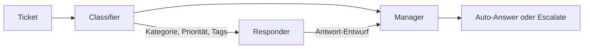

# Ticket-Agent

Ein kleines Multi-Agenten-System für Support-Tickets. Drei KI-Agenten arbeiten nacheinander: Einer klassifiziert das Ticket, einer entwirft die Antwort-E-Mail, einer entscheidet, ob automatisch geantwortet oder an einen Menschen eskaliert wird. Gebaut mit CrewAI und einem lokalen Modell über Ollama.

## So funktioniert es



| Agent | Aufgabe | Ergebnis |
|---|---|---|
| Classifier | Ticket analysieren | Kategorie, Priorität, bis zu 3 Tags, kurze Begründung |
| Responder | Antwort schreiben, nutzt die Klassifikation | E-Mail mit Betreff, Anrede, Inhalt und Grußformel |
| Manager | Klassifikation und Entwurf prüfen | Entscheidung (Auto-Answer oder Escalate) mit Begründung |

Die Agents laufen in fester Reihenfolge (`Process.sequential`). Jede Task bekommt über `context` die Ergebnisse der vorherigen Tasks. Die Agents delegieren nicht untereinander (`allow_delegation=False`), und mit `verbose=True` sieht man im Terminal, was jeder Agent gerade tut.

## Beispiel

Eingabe:

```
ID: T001
Betreff: Login funktioniert nicht
Beschreibung: Seit dem Update kann ich mich nicht mehr einloggen. Bekomme immer Fehler 403.
```

Ausgabe:
**Entscheidung:** Automatische Antwort

**Begründung:**

Das Ticket wurde als Zugangskategorie klassifiziert, da es sich um ein Problem mit der Login-Funktion handelt. Die Priorität wurde auf Hoch gesetzt, da der Benutzer bereits ein Update durchgeführt hat und nun Probleme mit der Login-Funktion hat. Die Tags #login und #zugang wurden gesetzt, um die relevante Abteilung zu kennzeichnen. Das Ticket wurde auch als dringend klassifiziert, da der Benutzer bereits ein Update durchgeführt hat und nun Probleme mit der Login-Funktion hat.

Basierend auf dieser Klassifizierung und den gesetzten Tags kann ich feststellen, dass das Ticket automatisch beantwortet werden kann. Die automatische Antwort kann die folgenden Informationen enthalten:

"Sehr geehrte/r [Name des Kunden],

vielen Dank für Ihre Nachricht und für die Gelegenheit, Ihnen bei Ihrem Problem mit der Login-Funktion zu helfen. Wir verstehen die Bedeutung einer schnellen Lösung und werden daher mit größter Sorgfalt auf Ihre Anfrage eingehen.

Unser Team wird Ihre Anfrage sorgfältig prüfen und die notwendigen Schritte unternehmen, um die Login-Funktion zu reparieren. Wir werden Ihnen regelmäßige Updates über den Fortschritt Ihrer Anfrage senden, um Sie über die aktuellen Entwicklungen zu informieren.

Wir schätzen Ihre Geduld und Ihre Kooperation und sind überzeugt, dass wir Ihnen helfen können, Ihre Login-Funktion wieder zu aktivieren. Wenn Sie weitere Fragen oder Bedenken haben, stehe ich Ihnen gerne zur Verfügung.

Mit freundlichen Grüßen,
[Ihr Name]
Customer Support
[Unternehmen]"

## Technik

Python, CrewAI, Ollama (`llama3.2`, Temperature 0.2 für stabilere Klassifikation)

## Setup

```powershell
git clone https://github.com/NabinAd/ai-portfolio
cd ai-portfolio/ticket-agent

python -3.12 -m venv .venv
.\.venv\Scripts\Activate.ps1

python -m pip install --upgrade pip
python -m pip install -r requirements.txt

ollama pull llama3.2
python ticket_agent.py
```

Ollama muss im Hintergrund laufen (Standard: `http://localhost:11434`). Eigene Tickets trägst du in der Liste `test_tickets` am Ende von `ticket_agent.py` ein.

